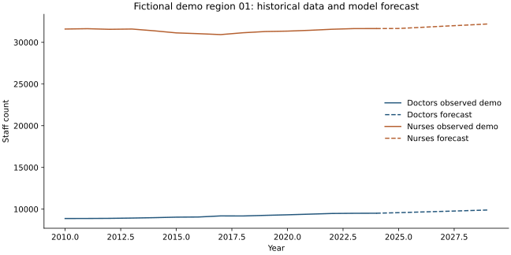
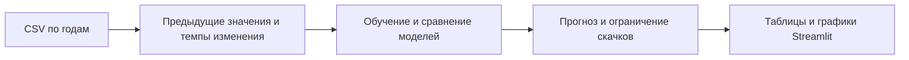

# Прогнозирование численности медицинских работников

**Python · pandas · scikit-learn · Streamlit · Plotly**

Учебное приложение: просмотр региональных показателей, сравнение моделей
и прогноз численности врачей и среднего медперсонала. Пользователь выбирает
регион и горизонт прогноза, получает таблицы и интерактивные графики.

> Публичная версия запускается на явно обозначенных искусственных данных.
> Это демонстрация программного цикла, а не медицинская рекомендация или
> проверенный прогноз для настоящих регионов.



## Возможности

- История показателей по годам и регионам.
- Прогноз на 1–5 лет с ограничением резких скачков.
- Сравнение Ridge, Random Forest, Gradient Boosting, дерева решений и KNN.
- Условная оценка нехватки кадров по нормативу, который задаёт пользователь.



## Запуск за несколько команд

Рекомендуется Python 3.11 или 3.12. PowerShell, из папки проекта:

```powershell
py -3 -m venv .venv
.\.venv\Scripts\python.exe -m pip install -r requirements.txt
.\.venv\Scripts\python.exe scripts/make_demo_data.py
.\.venv\Scripts\python.exe model_training.py
.\.venv\Scripts\python.exe -m streamlit run app.py
```

Открыть **http://127.0.0.1:8501**. На Linux использовать `python3` и `.venv/bin/python`.
Модели обучаются локально, готовые бинарные модели из чужого окружения не нужны.

## Как устроен проект

| Файл | Назначение |
|---|---|
| `app.py` | Пять экранов Streamlit, графики, прогноз и условная потребность |
| `model_training.py` | Подготовка выборок, сравнение и сохранение моделей |
| `src/features.py` | Значения предыдущих лет и темпы изменения |
| `scripts/make_demo_data.py` | Воспроизводимые демонстрационные данные |
| `tests/` | Проверки подготовки данных, годовых лагов и разделения признаков и целей |

## Проверки

```powershell
.\.venv\Scripts\python.exe -m unittest discover -s tests -v
```

[Результаты технической проверки](docs/VERIFICATION.md).

## Что важно понимать про результаты

Модели прогнозируют следующий год. На несколько лет прогноз строится
последовательно и смешивается с региональным трендом; это отдельная эвристика.
Плавность прогноза сама по себе не доказывает точность.

Последние доступные годы используются для выбора модели. Поэтому показанная
таблица — сравнение при выборе, а не независимая окончательная оценка качества.
Полноценная проверка требует ещё одного временного отрезка и сравнения
с простым прогнозом «как в прошлом году». Нормативы потребности условные.

[Происхождение данных и формат CSV](data/README.md).
Оригинальный текст диплома, личные сведения и неподтверждённые данные в
репозиторий не входят.

[Другие проекты автора](https://github.com/davessii)
